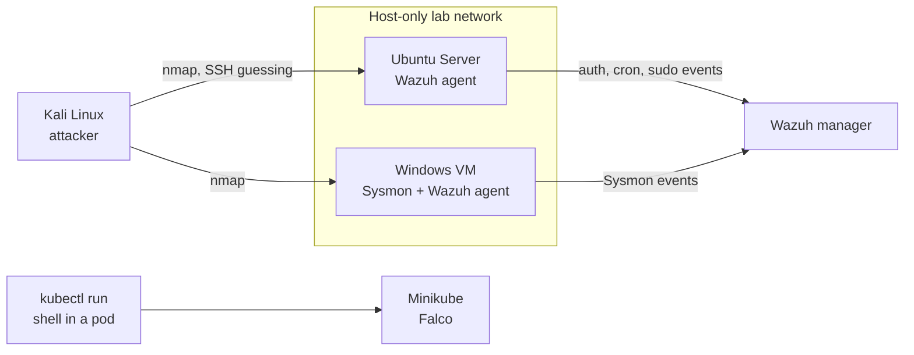

# Lab 7: Adversary Emulation

## Objective

This lab simulates a realistic attack chain in a controlled home lab environment and documents how each phase is detected by security tools.

## Result

A six-phase attack chain plus a container runtime test produced **18 technique checks** (17 ATT&CK techniques, with Network Service Discovery checked in both Wazuh and Sysmon): **8 detected, 3 partially detected and 7 not detected**. Wazuh caught password guessing, SSH logins, cron persistence and sudo abuse. Basic Linux discovery commands and tar-based collection went undetected, which points to auditd and file integrity monitoring as the next improvements. The full matrix is in [`mitre-matrix/attack-detection-matrix.md`](mitre-matrix/attack-detection-matrix.md).

| Phase | Detected | Partial | Not detected |
|---|---:|---:|---:|
| Reconnaissance | 0 | 1 | 1 |
| Initial Access | 2 | 0 | 0 |
| Persistence | 2 | 0 | 0 |
| Privilege Escalation | 2 | 0 | 0 |
| Discovery | 0 | 2 | 3 |
| Collection | 0 | 0 | 3 |
| Container Runtime | 2 | 0 | 0 |
| **Total** | **8** | **3** | **7** |

## Architecture

## Screenshot

The ATT&CK detection matrix built from the Wazuh, Sysmon and Falco results:

## How to Run

**What you need:** VirtualBox or another hypervisor with a host-only network, a Kali Linux VM, an Ubuntu Server VM, a Windows VM with Sysmon, a Wazuh manager, and Minikube with Falco for the container step. Only run this against machines you own.

1. Install the Wazuh agent on the Ubuntu and Windows VMs and enroll them with the manager. Install Sysmon on Windows.
2. Follow the phase files in [`attacks/`](attacks/) in order:
   - **Recon:** `nmap -sV` against the targets
   - **Initial access:** failed SSH logins with made-up usernames
   - **Persistence:** a harmless cron job
   - **Privilege escalation:** `sudo` commands
   - **Discovery:** `whoami`, `uname -a`, `ps`, `ip a`
   - **Collection:** a `tar` archive of fake files
3. After each phase, search Wazuh (or Sysmon, or Falco) for matching alerts and record the result. The notes for each phase are in [`detections/`](detections/).
4. For the container step, run `kubectl run -it --rm shell-test --image=ubuntu:22.04 -- bash` and check the Falco logs.
5. Remove the cron job and the test files afterwards. The cleanup steps are in [`evidence/`](evidence/).

## Attack Chain

1. Recon
2. Initial Access
3. Persistence
4. Privilege Escalation
5. Discovery
6. Collection

## Detection Tools

- Wazuh
- Falco
- Sysmon, if Windows telemetry is used

## Safety Scope

This lab will only be performed against systems owned and controlled in my home lab.

No public IP addresses, third-party systems, production systems, company systems, or unauthorized networks will be targeted.

All attack activity is simulated for defensive learning, detection engineering, and incident response documentation.

## Deliverables

- Attack notes
- Evidence files
- Detection notes
- ATT&CK matrix
- Final lab summary
