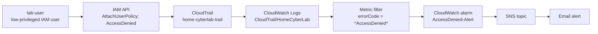
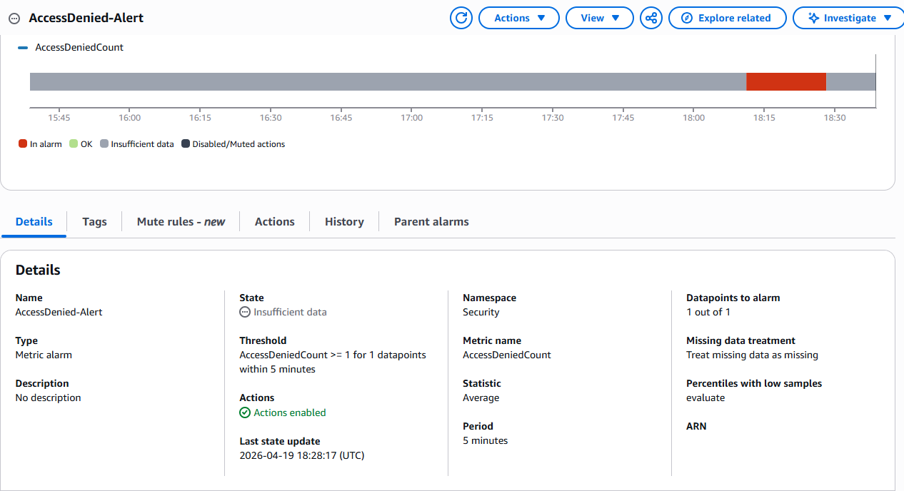

# AWS IAM Attack Simulation & Detection Lab

## Project Summary

This project demonstrates a cloud-native detection and alerting pipeline in AWS by simulating real-world IAM attack scenarios and building monitoring to detect them.

The lab integrates CloudTrail, CloudWatch Logs, metric filters, alarms, and SNS to create a full detection workflow from attacker activity to real-time alerting.

## Result

A low-privileged IAM user's attempt to attach `AdministratorAccess` to itself was denied, logged by CloudTrail, matched by the `AccessDenied` metric filter, and set off the CloudWatch alarm (**threshold: 1 or more events in 5 minutes**), which sent an **SNS email alert**. No privilege escalation succeeded.

## Architecture



## Screenshots

The metric filter that turns `AccessDenied` CloudTrail events into a metric:


The alarm moving to "In alarm" after the attempted privilege escalation (ARN with the account ID removed):



## How to Run

**What you need:** an AWS account you can use for testing, the AWS CLI, and an email address for the SNS alert.

1. Create a CloudTrail trail that sends logs to a CloudWatch Logs log group.
2. Create the metric filter on that log group (the pattern is in [`notes/detection-rules.md`](notes/detection-rules.md)):
   ```bash
   aws logs put-metric-filter --log-group-name <log-group> --filter-name AccessDeniedActivity \
     --filter-pattern '{ $.errorCode = "*AccessDenied*" }' \
     --metric-transformations metricName=AccessDeniedCount,metricNamespace=Security,metricValue=1
   ```
3. Create an SNS topic, subscribe your email and confirm the subscription.
4. Create a CloudWatch alarm on `Security/AccessDeniedCount` (Sum of 1 or more over 5 minutes) that notifies the SNS topic.
5. Create a test IAM user with no admin rights, configure its access key in a separate CLI profile, and try to escalate:
   ```bash
   aws iam attach-user-policy --user-name lab-user \
     --policy-arn arn:aws:iam::aws:policy/AdministratorAccess --profile lab-user
   ```
6. Within a few minutes the alarm should move to "In alarm" and send the email. Afterwards, delete the test user's access key and the user.

## Why This Project Matters

This project goes beyond basic cloud setup by simulating attacker behavior and validating detection capabilities. It demonstrates practical cloud security monitoring, detection engineering, and incident response concepts.

## Skills Demonstrated

- AWS Cloud Security

- Detection Engineering

- IAM Security Monitoring

- CloudWatch and CloudTrail Integration

- Incident Response Workflow

- CLI-based Attack Simulation

## Lab Environment

### Technologies Used

- AWS CloudTrail

- AWS CloudWatch Logs

- AWS CloudWatch Alarms

- AWS SNS

- AWS IAM

- AWS CLI

### Components

- CloudTrail logging across the account

- CloudWatch log ingestion

- Metric filters for detection

- Alarm-based alerting

- SNS email notifications

- IAM user used for attack simulation

## Attack Simulation

The following attacker behaviors were simulated using AWS CLI:

- Enumerating IAM users

- Checking attached policies

- Attempting privilege escalation with AttachUserPolicy

- Attempting persistence with CreateAccessKey

## Detection Engineering

A metric filter was created to detect unauthorized actions.

**Filter Pattern**

{ $.errorCode = "\*AccessDenied\*" }

This captures failed or unauthorized API actions, which are common indicators of attacker activity.

## Alerting

- CloudWatch Alarm triggers when AccessDenied events are greater than or equal to 1

- SNS sends real-time email alerts

- Alerts confirm the detection pipeline is working

## Outcome

Successfully built and validated a cloud detection pipeline:

Attacker Action → CloudTrail Log → CloudWatch Detection → Alarm → SNS Alert

## Project Evidence

Screenshots to add:

- CloudTrail configuration

- Log group activity

- Metric filter setup

- Alarm configuration

- SNS alert email

- CLI attack commands


