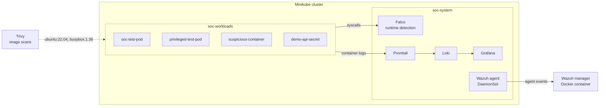

# Cloud-Native SOC for Kubernetes Workloads

## Project Overview

This project builds a cloud-native SOC lab for Kubernetes workloads. The goal is to simulate suspicious Kubernetes activity, detect runtime behavior, investigate logs, scan container images, validate Wazuh detections, and document the full attack-detect-investigate workflow.

## Result

Falco flagged interactive shells in **2 of 2** test pods, and Wazuh rule **5710** matched a failed SSH login test event and mapped it to MITRE T1110.001. Trivy found **1 HIGH** vulnerability in `ubuntu:22.04` (a `libssl3` issue with a fix available) and **0** in `busybox:1.36`.

## Screenshots

Falco alerts for shells spawned inside the test pods:


Wazuh decoding a failed-login test event and matching rule 5710:


## How to Run

**What you need:** Docker Desktop, Minikube, `kubectl`, Helm and Trivy. PowerShell is optional; it's only needed for the helper scripts.

1. Start a cluster and create the namespaces:
   ```bash
   minikube start
   kubectl create namespace soc-system
   kubectl create namespace soc-workloads
   ```
2. Install Falco and the Loki stack (Loki, Promtail and Grafana):
   ```bash
   helm repo add falcosecurity https://falcosecurity.github.io/charts
   helm repo add grafana https://grafana.github.io/helm-charts
   helm install falco falcosecurity/falco -n soc-system
   helm install loki grafana/loki-stack -n soc-system --set grafana.enabled=true
   ```
3. Run the Wazuh manager in Docker, then deploy the agent DaemonSet, which connects to the manager at `host.minikube.internal`:
   ```bash
   docker run -d --name wazuh-manager -p 1514:1514 -p 1515:1515 wazuh/wazuh-manager:4.14.1
   kubectl apply -f manifests/wazuh-agent-daemonset.yaml
   ```
4. Deploy the test workloads and open a shell to trigger Falco:
   ```bash
   kubectl apply -f manifests/privileged-test-pod.yaml -f manifests/suspicious-container.yaml
   kubectl exec -it -n soc-workloads privileged-test-pod -- bash
   ```
5. Scan the images with `trivy image ubuntu:22.04` and `trivy image busybox:1.36`.
6. Check everything with `scripts/validate-cloud-native-soc.ps1`, and clean up with `scripts/cleanup-cloud-native-soc.ps1`.

## Core Components

- Kubernetes / Minikube
- Falco
- Wazuh
- Grafana
- Loki
- Promtail
- Trivy
- Docker
- PowerShell

## Architecture



## Simulations Completed

1. Interactive shell inside a container
2. Privileged pod shell activity
3. Kubernetes Secret access simulation
4. Suspicious container simulation
5. Container image vulnerability scanning
6. Wazuh failed-login detection validation

## Confirmed Results

- Kubernetes cluster deployed successfully.
- Falco detected shell activity inside containers.
- A privileged pod was deployed and investigated.
- A fake Kubernetes Secret was created and accessed for investigation.
- A suspicious container generated logs for review.
- Loki and Promtail collected Kubernetes workload logs.
- Grafana displayed workload logs from the soc-workloads namespace.
- Trivy generated image scan reports.
- Wazuh manager was deployed as a Docker container.
- Wazuh agent was deployed as a Kubernetes DaemonSet.
- Wazuh agent successfully connected to the Wazuh manager.
- Wazuh logtest validated a failed-login detection mapped to MITRE ATT&CK.

## Evidence and Reports

Key evidence is stored in the evidence folder.

Key reports are stored in the reports folder.

Important files:

- reports/final-validation.txt
- reports/final-project-status.txt
- reports/cloud-native-soc-workflow-summary.txt
- reports/investigation-note-008-wazuh-detection-validation.txt
- evidence/falco-shell-detection.txt
- evidence/falco-privileged-shell-detection.txt
- evidence/wazuh-agent-registration-confirmed.txt
- evidence/wazuh-logtest-failed-login.txt
- evidence/trivy-ubuntu-scan.txt
- screenshots/grafana-loki-soc-workloads-logs.png

## Attack-Detect-Investigate Workflow

1. Deploy Kubernetes workload.
2. Simulate suspicious or risky activity.
3. Detect runtime activity with Falco.
4. Review centralized logs in Grafana/Loki.
5. Scan container images with Trivy.
6. Validate Wazuh detection logic.
7. Save evidence.
8. Write investigation notes.
9. Run final validation.
10. Document the full workflow.

## Scripts

Validation script:

scripts/validate-cloud-native-soc.ps1

Cleanup script:

scripts/cleanup-cloud-native-soc.ps1

## Final Outcome

This lab demonstrates a complete cloud-native SOC workflow for Kubernetes workloads. It combines runtime detection, SIEM-style validation, centralized logging, image vulnerability scanning, Kubernetes investigation, evidence collection, and final reporting.
