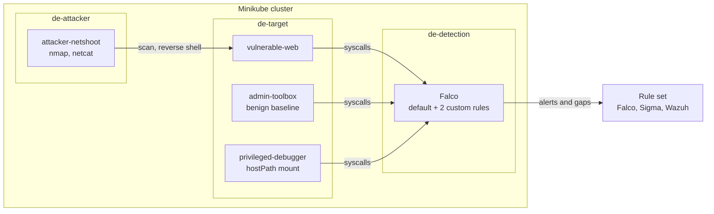
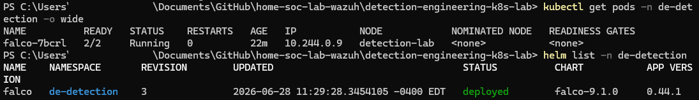

# Detection Engineering Kubernetes Lab

## Overview
This lab demonstrates a Kubernetes-focused detection engineering workflow. The goal was to simulate attacker behavior, collect evidence, identify detection gaps, create custom rules, and measure detection coverage.

## Result

Default Falco rules detected **2 of 4** attack scenarios. Two custom Falco rules closed the gaps (user creation and hostPath filesystem access), raising coverage to **4 of 4**, with **0 false positives** in a benign admin-command test. Coverage applies to these four lab scenarios only.

## Architecture



## Screenshot

Falco running in the `de-detection` namespace, deployed with Helm:



## How to Run

**What you need:** Docker Desktop, Minikube, `kubectl` and Helm.

1. Start a cluster and create the three namespaces:
   ```bash
   minikube start
   kubectl create namespace de-target
   kubectl create namespace de-attacker
   kubectl create namespace de-detection
   ```
2. Install Falco with the two custom rules:
   ```bash
   helm repo add falcosecurity https://falcosecurity.github.io/charts
   helm install falco falcosecurity/falco -n de-detection -f rules/falco/custom-rules-values.yaml
   ```
3. Deploy the target and attacker pods:
   ```bash
   kubectl apply -f manifests/
   ```
4. Run a scenario, for example the internal Nmap scan, and check Falco:
   ```bash
   kubectl exec -n de-attacker attacker-netshoot -- nmap -sV vulnerable-web.de-target.svc.cluster.local
   kubectl logs -n de-detection -l app.kubernetes.io/name=falco -c falco --tail 20
   ```
   The commands for the other three scenarios are in [`attacks/`](attacks/).
5. Clean up with `scripts/cleanup-lab.ps1` (PowerShell) or `minikube delete`.

The Sigma and Wazuh versions of each rule are in [`rules/`](rules/).

## Lab Objectives
- Simulate realistic Kubernetes attack behaviors
- Collect raw telemetry and alert evidence
- Validate default Falco detection coverage
- Identify detection gaps
- Create custom Falco rules
- Create Sigma detection rules
- Create Wazuh custom rules
- Map activity to MITRE ATT&CK
- Measure detection coverage and false positives

## Tools Used
- Kubernetes
- Minikube
- Docker Desktop
- kubectl
- Helm
- Falco
- Sigma
- Wazuh custom rules
- Nmap
- Netcat
- PowerShell

## Kubernetes Namespaces

| Namespace | Purpose |
|---|---|
| de-target | Target workloads |
| de-attacker | Attacker simulation pod |
| de-detection | Detection tooling |

## Attack Scenarios

| Attack ID | Scenario | Tool / Technique | Detection Result |
|---|---|---|---|
| ATTACK-001 | Internal Nmap service scan | nmap | Detected by Falco default rule |
| ATTACK-002 | User creation inside container | useradd | Detected after custom Falco rule |
| ATTACK-003 | Privileged pod host filesystem access | hostPath + privileged pod | Detected after custom Falco rule |
| ATTACK-004 | Reverse shell from container | bash + TCP redirection | Detected by Falco default rule |

## Custom Falco Rules Created
- Suspicious User Management Command in Container
- Host Filesystem Access Through Mounted HostPath

## Sigma Rules Created
- k8s-container-nmap-packet-socket.yml
- k8s-container-user-management-command.yml
- k8s-container-hostpath-filesystem-access.yml
- k8s-container-reverse-shell-network-redirection.yml

## Wazuh Rules Created
- kubernetes-detection-engineering-rules.xml

## MITRE ATT&CK Mapping

| Attack ID | MITRE Technique | Tactic |
|---|---|---|
| ATTACK-001 | T1046 - Network Service Discovery | Discovery |
| ATTACK-002 | T1136.001 - Create Account: Local Account | Persistence |
| ATTACK-003 | T1611 - Escape to Host | Privilege Escalation |
| ATTACK-004 | T1059 - Command and Scripting Interpreter | Execution / Command and Control |

## Coverage Summary
Total attack scenarios tested: 4  
Detected scenarios: 4  
Coverage: 100% for tested lab scenarios

## Important Note
The 100% coverage score only applies to the controlled scenarios tested in this lab. It does not mean the detection set covers every Kubernetes attack technique.

## Evidence
Evidence is organized under:

- evidence/raw-telemetry
- evidence/alerts
- evidence/coverage
- evidence/false-positives

## Reports
Final summaries are stored under:

- reports/mitre-attack-mapping.md
- reports/detection-coverage-summary.md
