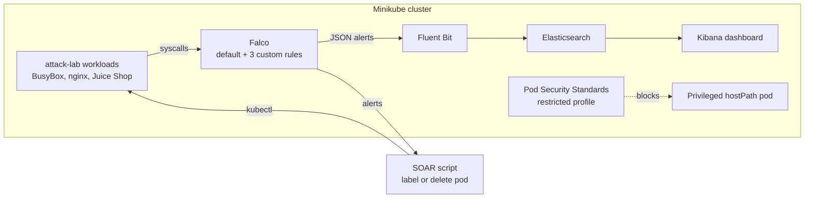
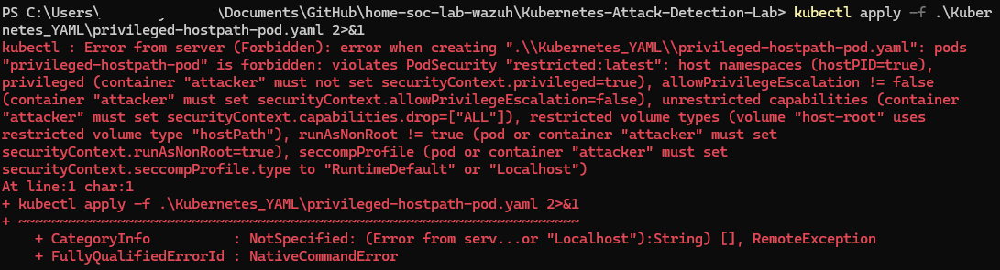

# Kubernetes Attack Detection and Response Lab

## Overview

This project is a hands-on Kubernetes blue team lab focused on attack detection, investigation, containment, hardening, detection engineering, and centralized alert visibility.

The lab simulates a compromised Kubernetes environment where suspicious activity is generated from containers, detected with Falco, investigated with Kubernetes evidence, contained through response actions, hardened using Kubernetes security controls, and visualized through Elasticsearch and Kibana.

---

## Result

Default Falco rules raised **0 alerts** for `wget`/`nc` network discovery inside a pod. Three custom Falco rules closed that gap and **fired 3 of 3** in testing. Pod Security Standards (`restricted`) then rejected the privileged hostPath pod for **7 policy violations**, and after hardening the same attack could no longer read `/etc/shadow`.

## Architecture



## Screenshots

Falco alerts from the custom rules, forwarded to Elasticsearch and viewed in Kibana:


Pod Security Standards rejecting the privileged hostPath pod:



## How to Run

**What you need:** Docker Desktop, Minikube, `kubectl`, Helm, and Python 3 (for the SOAR script). The lab was built on Windows 11; the same commands work on Linux or macOS.

1. Start a cluster and create the lab namespace:
   ```bash
   minikube start
   kubectl create namespace attack-lab
   ```
2. Install Falco with the custom rules and JSON output:
   ```bash
   helm repo add falcosecurity https://falcosecurity.github.io/charts
   helm install falco falcosecurity/falco -n falco --create-namespace \
     -f falco-rules/custom-falco-values.yaml -f falco-rules/falco-json-output-values.yaml
   ```
3. Deploy the target workloads:
   ```bash
   kubectl apply -f kubernetes-yaml/base-workloads.yaml
   ```
4. Run an attack from the BusyBox pod and watch Falco:
   ```bash
   kubectl exec -n attack-lab busybox -- sh -c "id; cat /etc/shadow; wget -qO- http://nginx"
   kubectl logs -n falco -l app.kubernetes.io/name=falco -c falco --tail 20
   ```
5. Optional: deploy the logging stack (`elasticsearch.yaml`, `fluent-bit-falco-to-elasticsearch.yaml`, `kibana.yaml`), or run the SOAR watcher in safe label-only mode with `python scripts/falco_soar_response.py`.
6. To test hardening, label the namespace with `pod-security.kubernetes.io/enforce=restricted` and apply `kubernetes-yaml/privileged-hostpath-pod.yaml`. It should be rejected.

Clean up with `minikube delete`.

---

## Lab Goals

The goals of this project were to:

- Deploy a Kubernetes attack lab environment
- Simulate suspicious container activity
- Detect shell execution and sensitive file access with Falco
- Investigate a privileged hostPath pod
- Contain a compromised workload
- Rotate a Kubernetes secret
- Apply Pod Security Standards
- Deploy hardened workloads
- Create custom Falco detection rules
- Forward Falco alerts to Elasticsearch with Fluent Bit
- Build a Kibana dashboard for alert analysis
- Document the full incident response process

---

## Tools Used

- Windows 11
- Docker Desktop
- Minikube
- kubectl
- Helm
- Falco
- Fluent Bit
- Elasticsearch
- Kibana
- BusyBox
- nginx
- OWASP Juice Shop
- PowerShell
- VS Code

---

## Lab Architecture

High-level workflow:

Falco detects suspicious runtime activity from Kubernetes workloads.

Falco outputs alerts in JSON format.

Fluent Bit collects Falco container logs from the Kubernetes node.

Fluent Bit forwards matching Falco alert records to Elasticsearch.

Kibana visualizes the Falco alerts using the falco-alerts-* index.

Attack and response evidence is saved locally in the evidence folder.

---

## Workloads Deployed

The lab deployed the following workloads in the attack-lab namespace:

- Juice Shop
- nginx
- BusyBox
- Hardened BusyBox
- Hardened nginx
- Privileged hostPath pod for controlled testing

---

## Attack Simulations

The lab simulated several attacker behaviors:

### Attack 001 - Interactive Shell and Sensitive File Access

A shell was opened inside the BusyBox pod.

The attacker attempted to read:

- /etc/shadow

Falco detected:

- Shell spawned in a container
- Sensitive file opened for reading

Evidence:

- evidence/attack-001-busybox-shell-shadow-falco-alerts.txt
- evidence/attack-001-busybox-pod-describe.txt
- evidence/attack-001-kubernetes-events.txt

---

### Attack 002 - Internal Network Discovery

The BusyBox pod was used to test internal service access with tools such as:

- wget
- nc

Finding:

Default Falco visibility detected shell activity, but did not clearly detect all network discovery behavior.

Evidence:

- evidence/attack-002-network-discovery-falco-alerts.txt
- evidence/attack-002-network-discovery-detection-gap.md

---

### Attack 003 - Privileged hostPath Pod

A privileged pod was deployed with:

- privileged: true
- hostPID: true
- hostPath mount of /

The pod was able to inspect host paths through the /host mount.

Evidence:

- evidence/attack-003-privileged-hostpath-pod-yaml.txt
- evidence/attack-003-host-access-investigation.txt
- evidence/attack-003-privileged-hostpath-finding.md
- evidence/attack-003-privileged-hostpath-falco-alerts.txt

---

## Response Actions

The response phase included:

- Labeling the risky pod as compromised
- Deleting the privileged hostPath pod
- Rotating a Kubernetes secret
- Verifying workload state after containment
- Documenting response actions

Evidence:

- evidence/response-001-compromised-pod-labeled.txt
- evidence/response-001-pod-deleted-verification.txt
- evidence/response-001-containment-note.md
- evidence/response-002-secret-before-rotation.yaml
- evidence/response-002-secret-after-rotation.yaml
- evidence/response-002-secret-rotation-note.md

---

## Hardening Controls

The lab implemented or documented the following hardening controls:

- Pod Security Standards using the restricted profile
- Non-root container execution
- Read-only root filesystem
- Dropped Linux capabilities
- RuntimeDefault seccomp profile
- Resource requests and limits
- Secret rotation
- NetworkPolicy enforcement gap documentation

Pod Security Standards successfully blocked the privileged hostPath pod from being deployed again.

Evidence:

- evidence/hardening-001-pod-security-standards-labels.txt
- evidence/hardening-001-privileged-pod-blocked.txt
- evidence/hardening-001-pod-security-standards-note.md
- evidence/hardening-003-hardened-busybox-yaml.txt
- evidence/hardening-003-hardened-nginx-deployment-yaml.txt
- evidence/hardening-004-hardened-busybox-attack-rerun.txt

---

## Detection Engineering

Three custom Falco rules were created:

1. K8s Attack Lab Interactive Shell
2. K8s Attack Lab Shadow File Read
3. K8s Attack Lab Network Discovery Tool

The custom rules successfully detected:

- Interactive shell execution
- /etc/shadow read attempts
- wget network discovery activity

Evidence:

- falco-rules/custom-falco-values.yaml
- evidence/detection-001-falco-custom-rules-loaded.txt
- evidence/detection-002-custom-falco-rule-test-alerts.txt
- evidence/detection-002-custom-falco-rule-test-note.md

---

## Stretch Goal

The stretch goal integrated:

Falco -> Fluent Bit -> Elasticsearch -> Kibana

Confirmed Elasticsearch index:

- falco-alerts-2026.07.07

Confirmed dashboard fields:

- rule
- priority
- time
- output_fields.k8s_ns_name
- output_fields.k8s_pod_name
- output_fields.user_name
- output_fields.user_uid
- output_fields.proc_cmdline

Kibana dashboard panels built:

- Falco Alerts Over Time
- Falco Alerts by Severity
- Falco Alerts by Namespace
- Falco Alerts by Pod
- Falco Alerts by Rule
- Falco Alerts by User UID

Evidence:

- evidence/stretch-003-falco-json-output-test.txt
- evidence/stretch-004-fluent-bit-startup-logs.txt
- evidence/stretch-007-elasticsearch-falco-index-created.txt
- evidence/stretch-008-elasticsearch-falco-key-fields.json
- evidence/stretch-009-elasticsearch-falco-key-fields-fixed.json
- evidence/stretch-010-kibana-dashboard-note.md

Screenshots:

- screenshots/Screenshot 2026-07-07 164451.png
- screenshots/Screenshot 2026-07-07 173340.png

---

## MITRE ATT&CK Mapping

The lab mapped activity to MITRE ATT&CK techniques including:

| Tactic | Technique ID | Technique |
|---|---:|---|
| Execution | T1059.004 | Unix Shell |
| Discovery | T1083 | File and Directory Discovery |
| Discovery | T1046 | Network Service Discovery |
| Discovery | T1613 | Container and Resource Discovery |
| Credential Access | T1552 | Unsecured Credentials |
| Privilege Escalation | T1611 | Escape to Host |

See:

- MITRE_Mapping.md

---

## Key Findings

1. Falco detected shell execution and sensitive file access.
2. Default detections did not clearly cover all network discovery behavior.
3. Custom Falco rules improved detection coverage.
4. Privileged containers with hostPath mounts create serious escape risk.
5. Pod Security Standards blocked the dangerous privileged workload.
6. Hardened workloads reduced attacker capability after shell access.
7. NetworkPolicy requires an enforcing CNI such as Calico or Cilium.
8. Centralized alerting with Elasticsearch and Kibana improved visibility.

---

## Project Structure

kubernetes-attack-detection-lab/
- README.md
- MITRE_Mapping.md
- Hardening_Checklist.md
- Lessons_Learned.md
- falco-rules/
- kubernetes-yaml/
- screenshots/
- evidence/
- reports/
- scripts/

---

## Reports

Main incident report:

- reports/Incident_Report.md

Additional documentation:

- MITRE_Mapping.md
- Hardening_Checklist.md
- Lessons_Learned.md

---

## Status

Completed:

- Cluster workload deployment
- Falco validation
- Attack simulation
- Investigation evidence collection
- Containment
- Secret rotation
- Pod Security Standards
- Hardened workloads
- Attack rerun after hardening
- Custom Falco rules
- Elasticsearch and Kibana stretch goal
- Kibana dashboard screenshots
- MITRE mapping
- Incident report draft
- Lessons learned
- SOAR-style Python auto-response script


---

## SOAR-Style Auto Response

A Python SOAR-style response script was created:

- scripts/falco_soar_response.py

The script watches Falco JSON alerts and automatically responds to high-risk Kubernetes events.

The script can:

- Read Falco JSON alerts
- Identify the offending pod
- Identify the namespace
- Label the pod as compromised
- Optionally delete the pod
- Log response actions locally

Safe label-only mode was tested first.

Delete mode was then tested against a disposable pod named:

- soar-test-busybox

SOAR evidence:

- evidence/soar-actions.log
- evidence/soar-001-action-log.txt
- evidence/soar-001-pod-labeled-by-script.txt
- evidence/soar-001-auto-response-note.md
- evidence/soar-delete-actions.log
- evidence/soar-002-delete-mode-action-log.txt
- evidence/soar-002-delete-mode-pod-removed-verification.txt
- evidence/soar-002-delete-mode-note.md

Result:

The script successfully labeled a suspicious pod as compromised and successfully deleted a disposable test pod in delete mode.
