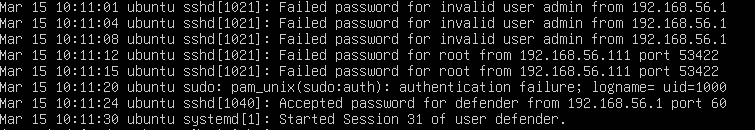
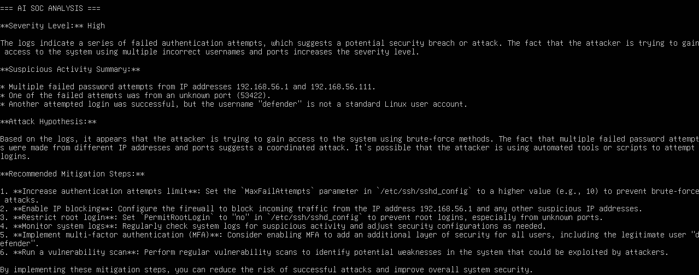
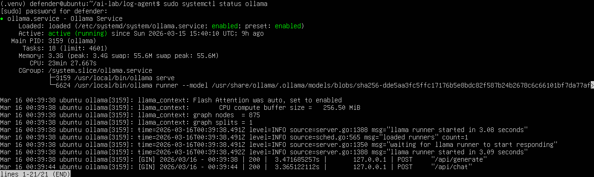

# AI Log Analysis Agent

A beginner-friendly AI security project that uses a local LLM through Ollama to analyze Linux authentication logs and generate a SOC-style incident summary.

---

## Project Summary

This project was built in a home cybersecurity lab to combine:

- Linux log analysis
- Python automation
- Local LLM inference
- SOC-style incident reporting

The agent reads authentication logs, looks for suspicious activity, and produces a structured security assessment with severity, attack hypothesis, and mitigation guidance.

---

## Objectives

- Build a simple AI-assisted SOC workflow
- Analyze Linux authentication logs locally
- Use Ollama for private LLM inference
- Create a portfolio-ready cybersecurity automation project

---

## Tools Used

- Kali Linux
- Ubuntu Server
- Metasploitable2
- VirtualBox
- Python 3
- Ollama
- Llama 3.2 3B
- LangChain

---

## Features

- Reads Linux authentication log data
- Detects suspicious login behavior
- Produces SOC-style analysis
- Works fully in a local lab
- Saves report output for documentation and review

---

## Project Structure

    log-agent/
    ├── README.md
    ├── reports/
    │   ├── soc_report.txt
    │   └── sample_soc_report.txt
    ├── samples/
    │   └── auth_sample.log
    ├── screenshots/
    │   ├── 01-project-structure.png
    │   ├── 02-sample-log.png
    │   ├── 03-script.png
    │   ├── 04-agent-run.png
    │   ├── 05-report-output.png
    │   ├── 06-ollama-working.png
    │   └── 07-ollama-service.png
    └── scripts/
        └── log_agent.py

---

## How It Works

1. A sample authentication log is provided to the Python script.
2. The script sends the log content to a local Ollama model.
3. The model analyzes the log data.
4. The agent returns:
   - Severity level
   - Suspicious activity summary
   - Attack hypothesis
   - Recommended mitigation steps

---

## Example Workflow

- Review authentication logs
- Identify repeated failed login attempts
- Flag suspicious access patterns
- Generate a short incident-style response

---

## Skills Demonstrated

- Virtual lab setup
- Linux command-line usage
- Python scripting
- Local LLM deployment
- AI-assisted log analysis
- Security reporting
- Basic SOC workflow automation

---

## Screenshots

The sample authentication log the agent reads (failed SSH logins, a failed sudo attempt and a successful login):

Two runs of the agent against the same log. The model rated it Moderate in one run and High in the other:

Ollama serving Llama 3.2 3B locally:

The project structure, script and first Ollama test are in [`screenshots/`](screenshots/) as `01`, `03` and `06`.

## Limitations

The model's output is saved as generated, and not all of its advice is correct. For example, the second run recommends raising a `MaxFailAttempts` setting in `sshd_config`, but sshd has no such option (the real one, `MaxAuthTries`, should be lowered, not raised). Its reports need an analyst's review, which is why the agent only drafts the summary.
