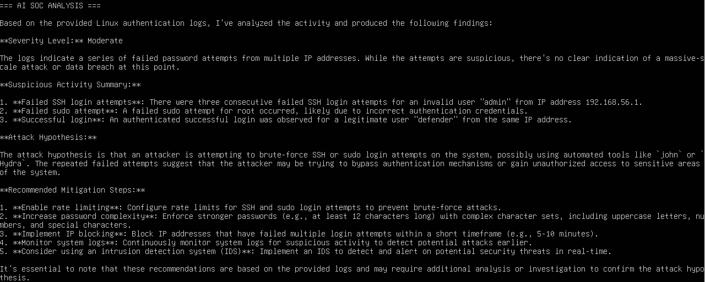

# AI Log Analysis Agent

A small Python script that sends a Linux authentication log to a local Llama 3.2 model through Ollama and prints a SOC-style report.

**What it does:** auth log → Llama 3.2 3B (local, via Ollama) → report with a severity level, a summary of suspicious activity, an attack hypothesis and recommended mitigations.

---

## How It Works

[`scripts/log_agent.py`](scripts/log_agent.py) does four things:

1. Reads the last 80 lines of an authentication log (`samples/auth_sample.log`).
2. Puts them into a prompt that asks for a severity level, a suspicious activity summary, an attack hypothesis and mitigation steps.
3. Sends the prompt to `llama3.2:3b` running locally in Ollama, using the `langchain-ollama` package.
4. Prints the model's answer to the terminal.

The script does not parse or score the log itself; all of the analysis comes from the model. The two saved reports in [`reports/`](reports/) are the printed output of two runs, saved by redirecting the output to a file.

## Lab Setup

- Ubuntu Server VM in VirtualBox, running Ollama and the script
- Python 3 with `langchain-ollama`
- Ollama with the `llama3.2:3b` model
- The sample log comes from failed SSH and sudo attempts against the Ubuntu VM in the same lab, from 192.168.56.1 and 192.168.56.111

## How to Run

```bash
ollama pull llama3.2:3b
pip install langchain-ollama
python scripts/log_agent.py > reports/soc_report.txt
```

The log path is set by `LOG_FILE` at the top of the script; change it to point to your own copy of `samples/auth_sample.log`.

## Project Structure

    log-agent/
    ├── README.md
    ├── reports/
    │   ├── soc_report.txt
    │   └── sample_soc_report.txt
    ├── samples/
    │   └── auth_sample.log
    ├── screenshots/
    │   ├── 01-project-structure.png
    │   ├── 02-sample-log.png
    │   ├── 03-script.png
    │   ├── 04-agent-run.png
    │   ├── 05-report-output.png
    │   ├── 06-ollama-working.png
    │   └── 07-ollama-service.png
    └── scripts/
        └── log_agent.py

## Screenshots

The sample authentication log the agent reads (failed SSH logins, a failed sudo attempt and a successful login):


Two runs of the agent against the same log. The model rated it Moderate in one run and High in the other:




Ollama serving Llama 3.2 3B locally:


The project structure, script and first Ollama test are in [`screenshots/`](screenshots/) as `01`, `03` and `06`.

## Limitations

- The model's output is saved as generated, and not all of its advice is correct. For example, the second run recommends raising a `MaxFailAttempts` setting in `sshd_config`, but sshd has no such option (the real one, `MaxAuthTries`, should be lowered, not raised).
- The same log produced different severity ratings on two runs, so the output is a draft for an analyst to review, not a verdict.

## Future Enhancements

- Count failed logins per source IP in Python before calling the model, so the report rests on measured numbers
- Pass the log path as a command-line argument instead of editing the script
- Save each report automatically with a timestamp
- Ask the model for structured output (JSON) so reports can be compared between runs

## Skills Demonstrated

- Python scripting
- Running a local LLM with Ollama
- Prompt design for log analysis
- Reviewing AI output critically
