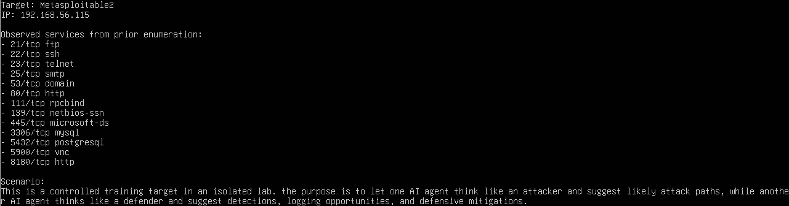
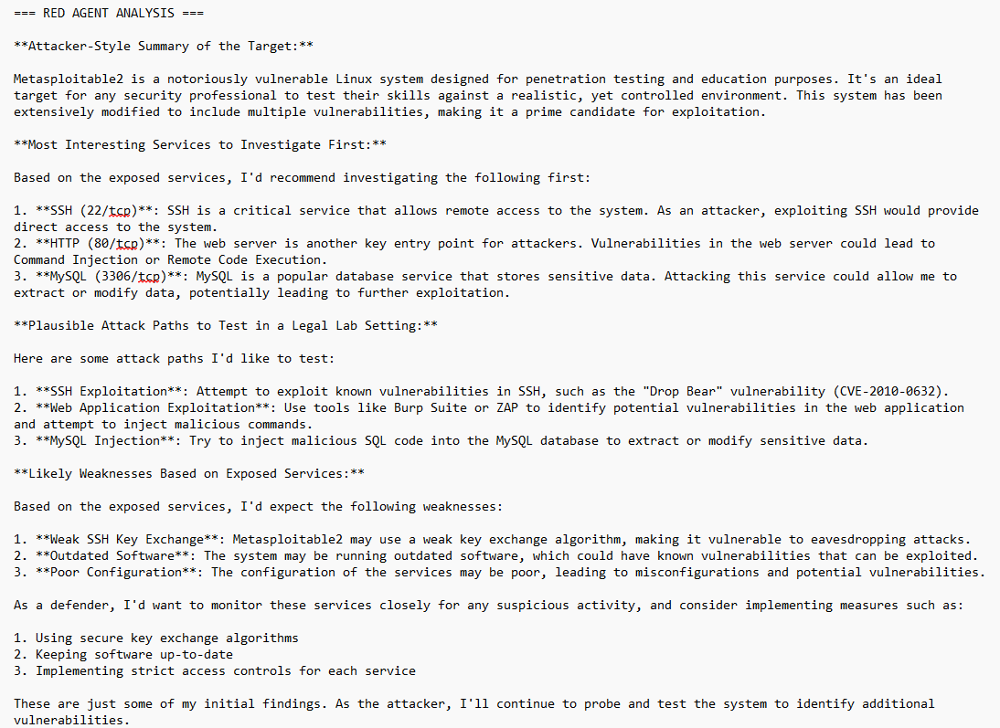
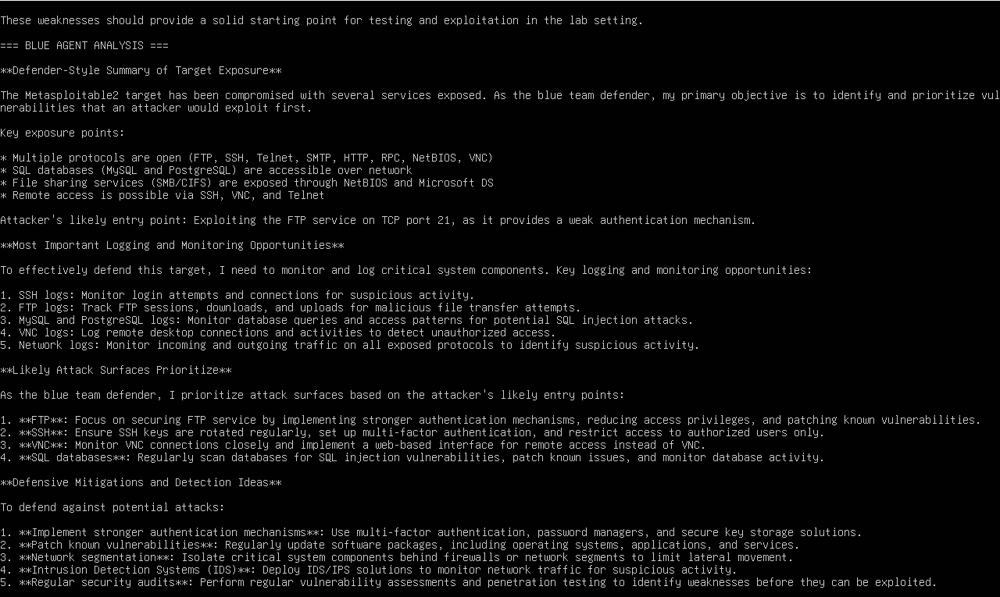

# Red vs Blue AI Agent Lab

## Overview

This project is a beginner-friendly multi-agent cybersecurity lab that simulates a simple red team versus blue team workflow using local AI. It uses sample target information and a local LLM through Ollama to generate both attacker-style and defender-style analysis.

## Project Goal

The goal of this project is to explore how AI agents can support both offensive and defensive security thinking in a controlled lab environment. This project demonstrates how one agent can suggest likely attack paths while another agent focuses on detection opportunities and defensive response.

## What the Agents Do

- Review target and service information

- Generate red team attack ideas

- Generate blue team detection and mitigation ideas

- Compare offensive and defensive perspectives

- Produce simple security-focused output for both sides

## Lab Environment

This project was built in a home lab using:

- Kali Linux

- Ubuntu Server

- Metasploitable2

- VirtualBox

- Python 3

- Ollama

- Llama 3.2 3B

- LangChain

## Project Structure

red-blue-agent-lab/

├── README.md

├── reports/

│ └── red_blue_analysis_report.txt

├── samples/

│ └── target_profile.txt

├── screenshots/

│ ├── 01-target-profile.png

│ ├── 02-script.png

│ ├── 03-agent-run.png

│ └── 04-report-output.png

└── scripts/

└── red_blue_agent.py

## How It Works

The project uses a sample target profile based on a controlled lab system. A Python script sends that target information to a local model through Ollama twice: once with a red team prompt and once with a blue team prompt. The result is a side-by-side style security exercise showing both offensive and defensive thinking.

## Screenshots

The target profile both agents receive (Metasploitable 2 and its open services):

The red team agent's analysis:

The blue team agent's analysis of the same target:

The script that sends both prompts to the local model is shown in [`screenshots/02-script.png`](screenshots/02-script.png).

## Skills Demonstrated

- Virtual lab setup

- Python scripting

- Local LLM deployment

- Offensive security reasoning

- Defensive security reasoning

- Security reporting

- Basic multi-agent security workflow design
